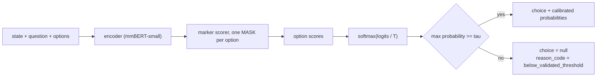
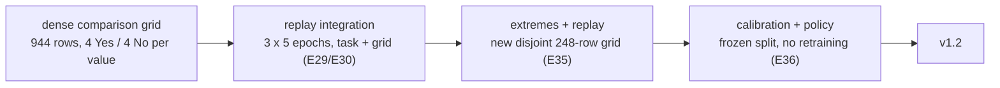
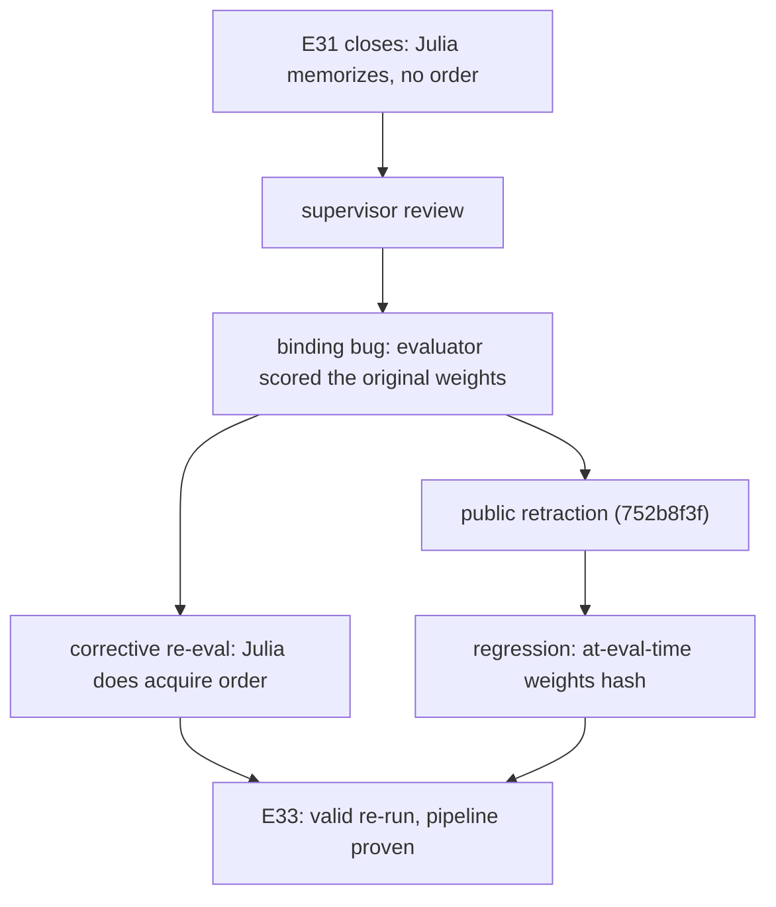

<p align="center"></p>

# MK-SH-1

A small open **decision model**: given a state, a question and a list of
described options, it returns calibrated probabilities, a choice, and when
confidence is too low, an explicit abstention. The repository carries the full
training and evaluation system behind it, plus a twelve-experiment research
campaign (E24 to E35, 2026-10-10/12) that taught the model a capability it did
not have and audited every step of that claim. Calibration and abstention were
added without retraining (E36).

Public model: **[Gjusev/MK-SH-1](https://huggingface.co/Gjusev/MK-SH-1)**.
v1.2 ships calibrated probabilities (T = 7.653) and a validated abstention
policy (tau = 0.79, 90 % coverage at a 5 % selective-risk budget) on weights
byte-identical to v1.1. Interactive demo:
**[Gjusev/MK-SH-1-demo](https://huggingface.co/spaces/Gjusev/MK-SH-1-demo)**
(source: [`demo/`](demo/)).

```
state:    "Me cobraron dos veces el mismo pedido."
question: "Which banking support intent does this customer request express?"
options:  [ transaction_charged_twice: "The same transaction was charged twice"
            top_up_reverted: "A top-up was reversed or reverted" ]
→  probabilities over the options (temperature-calibrated)
   choice (or null + reason_code when the policy abstains)
```

It is **not** a chat model and does not generate text for the decision. Each
option is scored in one encoder pass; softmax runs over the valid options only.

## The name

The mark holds a whale shark in the negative space between two tide bands
(the concept is called MAREA, Spanish for tide). It reads the way the model
works: the shape appears where the bands part, as a decision appears when a
value crosses a threshold line. MK-SH-1 is the first model of the MK family.

## The decision contract

One encoder, shared weights, a scalar score per option. The temperature is a
monotone transform: it never changes a choice, only the confidences. The
abstention rule was frozen before the coverage curve was ever plotted (E36).



## Use cases

<video src="https://raw.githubusercontent.com/Gjusev/MK-SH-1/main/demo/usecases/mksh-triage.mp4" autoplay muted loop playsinline width="100%"></video>

<p align="center"><sub>Illustrative scores through the shipped formula
(softmax at the fitted temperature, gate at tau). The decision contract at
work: question in, calibrated probability out, refusal below the gate.
Prefer a still? The [GIF](demo/usecases/mksh-triage.gif) and the
[interactive demo](https://huggingface.co/spaces/Gjusev/MK-SH-1-demo) are both up.</sub></p>

Each case names the measured capability it rests on, and where that
measurement stops.

1. **Threshold routing.** Decisions of the form "is the value at least the
   threshold stated in the question": limits, eligibility checks, price or
   risk cutoffs. Rests on numeric order measured at testC 0.979 on known
   thresholds and E-extrap 0.875 on fresh extreme thresholds (E27, E30, E35).
   Bound: validated on the numeric comparison contract in English
   (motor-temperature style states, one decimal to two); it is not a general
   numeric reasoner, and E-extrap is 7/8 pairs, not 10/10.
2. **Calibrated scoring with a safety valve.** Post-temperature probabilities
   (ECE 0.016 on the dedicated calibration split, E36) plus abstention at
   tau = 0.79: 90 % coverage with 4.86 % selective risk, which buys +2.85 pp
   accuracy on the cases the policy keeps. Suited to decision queues where
   refusals go to human review. Bound: the policy was fitted on the numeric
   surface; the routing task inherits the same global temperature (measured
   descriptively: NLL 2.535 to 0.588, ECE 0.184 to 0.045, no policy fit), and
   the easiest set is slightly over-softened (known-thresholds ECE 0.024 to
   0.042), the declared cost of one scalar.
3. **CPU and edge inference.** 106 ms per question at batch 1 on 8 CPU
   threads, fp32 (E22 v3, both models on the same harness). Bound: that is a
   tie with the Julia-1 reference at batch 1 and 5 to 10 % slower at batch 16;
   the earlier 1.35x speed claim was measured with a flawed v2 harness and is
   retracted below.
4. **A methodological template.** The recipe behind the capability: a dense
   anti-shortcut grid (4 Yes and 4 No per identical value, so any
   question-ignoring rule sits at exactly 0.500 on train), replay integration
   to keep the original task (E29, E30), replay-protected extremes (E35), then
   calibration on a split frozen before measurement (E36). A reproducible way
   to teach one new capability without catastrophic forgetting, demonstrated
   at 140M scale. Bound: one capability, one model family; the recipe is not
   claimed to generalize beyond what the campaign measured.

## Calibration and abstention (E36)


The temperature was fitted once, on 480 fresh questions, and it is monotone:
it changes no choices, only confidences. The abstention gate at tau = 0.79
keeps 90 % coverage at 4.86 % selective risk; below the gate the model returns
choice = null with reason_code below_validated_threshold.

## How the capability was built



Full entries with all caveats: `docs/experiments.md`. All criteria were frozen
and committed **before** each launch; every closure was adversarially reviewed
by an independent agent or session and every correction integrated.

One row per beat, commits included; the full per-experiment entries with
every caveat live in `docs/experiments.md`. Criteria were frozen and
committed before each launch; closures were adversarially reviewed and every
correction integrated.

| Beat | Experiments | Outcome | Key commits |
|---|---|---|---|
| Fit a numeric microset at all | E24 | Yes, 2/2 seeds in <60 steps | `f65bfb9f` `ca4644f4` |
| Threshold variation teaches a shortcut, not order | E25, E26, E26b/c | Decade shortcut fits the same data; breaking it kills the pass; ceiling replicated across 6 seeds | `ab8061ee` `e175b757` `b4201d5e` |
| Dense per-value coverage teaches real order | E27 | testC 0.979/1.000, transfers to fresh 2-decimal OOD; extrap + monotonicity declared weak | `aabab22a` `a9b2983d` |
| Extremes alone fail; seed-checked | E28, E28b | Big moves but not in both seeds; interference reading honored | `0a9ac914` `f3e05cae` |
| Replay protects; disjoint sample confirms | E29, E29b, E30 | No catastrophe; interference ~1/4 of no-replay; F1″ passes independently | `37d4fd01` `d5347639` |
| The invalid closure and its repair | E31, E33 | Binding bug found, claim retracted publicly, pipeline re-run valid | `d72b3066` `752b8f3f` `d6b34eae` |
| One-harness comparison, no architecture claims | E32, E34 | Julia transfers edges better but loses its own task faster with replay | `8d757b00` `f381940f` |
| Edges cracked; calibrated + gated | E35, E36 | E-extrap 0.875/0.857, task 0.800/0.783; T = 7.653, tau = 0.79 at 90% coverage | `cd972b4f` `169358e7` |

## The surviving differentiator (E32/E34, same CPU-float32 harness)

The integrated MOKKA version holds the newly acquired numeric-order
capability and its original task **at the same time**. The reference system
(Julia-1, adapted under a mirrored recipe) recovers a proxy task alongside
order but loses its own original task faster with replay than without (−27/−24
pp vs −14/−19 pp). Every advantage sentence in this README points at the
experiment and commit that measures it; the caveats travel with the claims.

## Rigor: the correction that defines this repository

The E31 story is told in full because it is the point, not an embarrassment:

1. **The bug.** The E31 stage fine-tuned Julia-1 on our 944-row grid, but its
   evaluator closed over a stage-scope engine holding the *original* weights.
   Dev-based stopping and all test evals measured the wrong model
   (`invalid_model_binding`). The closure claimed "Julia memorizes without
   order; our architecture and recipe are the differentiator."
2. **Detection and public retraction.** Supervisor review found the binding
   defect. The claim was **withdrawn in public commits** (`752b8f3f`,
   `1c2393c1`), the corrective re-evaluation showed Julia-1 *does* acquire
   order on our grid, and the frozen artifacts were left untouched with an
   invalidation notice.
3. **The regression that prevents recurrence.** `tests/test_e31_model_binding.py`
   fails on the pre-fix source: the eval engine must be passed explicitly, the
   inference-link guards are asserted (`engine.model is model`), and every
   eval demands an at-eval-time in-memory weights hash, the identity of the
   weights that actually produced each number.
4. **The valid repetition.** E33 re-ran the protocol with the corrected
   pipeline under pre-registered criteria plus a "live dev curve" validity
   check, declaring the contamination honestly: the results were already
   known from the corrective pass, so it validated the pipeline rather than
   discovering anything.
5. **The honest comparisons.** E32 (one CPU-float32 harness for both systems,
   double-validated against frozen history) and E34 (replay portability) close
   the comparison with every caveat visible. Recipes differ, so these are
   **system comparisons, and no architecture claim is possible**.



Criteria documents, frozen before each launch with verifiable commit order:
`docs/E32_CRITERIA…` through `docs/E36_CRITERIA…`, plus the internal protocol
family referenced from `docs/experiments.md`.

## Final comparison (E32 axis A + E34, one harness, CPU float32)


Recipes are NOT identical (uniform 2e-5 vs grouped LR, 30 vs ~300 epochs,
full-checkpoint vs encoder+head init): these are **complete-system**
comparisons. No architecture claims.

| Metric (final) | Mokka integrated (E30-MIX) | Julia adapted (E32, mean s42/s43) | Julia + replay (E34, s42/s43) |
|---|---|---|---|
| testC (order, known) | 0.979 | **1.000** (1 row ahead) | **1.000 / 1.000** |
| testE-interp (OOD) | 0.922 | 0.961 | 0.940 / 0.983 |
| testE-extrap (OOD) | 0.750 | **0.911** | n/a |
| Monotonicity (VE2) | **9/10** | 7/10 | n/a |
| Threshold-only pairs (22) | 13 | **16** | n/a |
| Its original task | routing 0.733 (recovered from 0.16) | typed-2000 −13.6/−19.0 pp | typed-2000 **−27.1/−23.5 pp**; proxy-task 0.83 |

Read it this way: adapted Julia transfers the numeric capability better at
range edges; the integrated Mokka version keeps monotonicity and recovers its
task. With replay, Julia holds a proxy task and order at once while its *own*
task degrades faster than without replay. The trade-off does not close. It
refines by which task is at stake.

## What survives, what does not

**Survives, measured and replicated:**

- Dense per-value coverage with 4-Yes/4-No balance teaches real numeric order
  (shortcuts mathematically excluded by construction; E27, replicated E28b).
- The integration recipe: capability and task coexist under replay mixing,
  validated on a disjoint sample (E29, E29b, E30).
- No catastrophic forgetting in either direction at these budgets (E29).
- The E31 to E33 correction arc and its permanent regression.
- Calibration without retraining: one global temperature fitted on a frozen
  split, choice behavior provably unchanged, abstention at a pre-declared
  rule (E36).

**Does not survive, declared limits:**

- Monotonicity is 9/10 at v1.0 and 8/10 at v1.1 (s43 reaches 10/10 but ships
  with lower E-extrap). Neither system is 10/10.
- Coexistence of order with *Julia's own* typed distribution fails under
  replay (E34).
- Any claim that the **architecture** is the differentiator. Recipes differ.
- OOD and threshold-transfer claims from E25 (the decade shortcut,
  retrospectively identified). Superseded by E26's review.
- **The historical efficiency advantage (~1.35x, E22 v2)**: the v3 formal
  measurement shows a tie at batch 1 and Julia 5 to 10 % ahead at batch 16.
  The v2 claim is retracted.
- The single global temperature slightly over-softens the easiest set
  (known-thresholds ECE 0.024 to 0.042). A per-type temperature is the
  obvious next step; one scalar was pre-declared here (E36).

## Reproduce

```bash
pip install -e .[data,train,baselines]
python -m pytest -q                    # suite: 200 pass (default env)
# .venv-julia (transformers==5.0.0): 194 pass + 1 skip
python scripts/prepare_data.py --config configs/pilot.yaml --out data/processed/v1   # deterministic
python scripts/gen_e25_thrvar.py && python scripts/verify_e25_thrvar.py              # data + independent verifier
python scripts/e27_report.py --out /tmp/r.json                                       # deterministic analyzers
python scripts/gen_e36_calib.py && python scripts/verify_e36_calib.py                # calibration split + verifier
python scripts/e36_report.py --out /tmp/e36.json                                     # refuses to overwrite; byte-exact
```

Campaign artifacts live under `runs/` (gitignored; every analysis directory
carries `artifact_hashes.json`; reports regenerate byte-exact). Training ran
on Kaggle free tier. See `docs/runbook-kaggle.md` for the quota discipline.
Version notes: `docs/RELEASE_NOTES_E24-E29b.md`. Internal status and decision
logs stay out of Git by standing instruction.

## Documentation

- `docs/experiments.md`: the full campaign record, one entry per experiment
- `docs/model-card.md`: trained artifacts, final metrics, limits, v1.2
  calibration section
- `docs/dataset-card.md`, `docs/evaluation-protocol.md`, `docs/runbook-kaggle.md`
- `docs/typed-decisions-protocol.md`: the typed-decisions contract
- `demo/`: the interactive Space (canonical source)

## License

Apache-2.0 for code. Datasets and third-party models keep their own licenses
(`THIRD_PARTY_NOTICES.md`).
